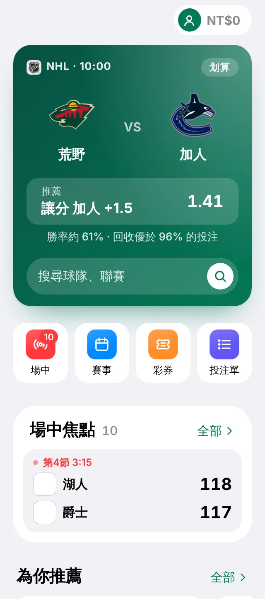

<p align="center">
  
</p>

<h1 align="center">Longshot</h1>

<p align="center">
  <b>A Taiwan sportsbook and lottery, on play money.</b><br>
  <a href="https://jaypengx.com/longshot/"><b>jaypengx.com/longshot</b></a>
</p>

<p align="center">
      
</p>

A sportsbook priced and settled like a real one, Taiwan Lottery's games, and the real 台灣運彩 tickets you bought, followed live. Everything you bet here is play money: the house never loses on its own prices, and the numbers show it.

<p align="center">
  
</p>

## Features

- **Sportsbook:** winners, spreads, totals, team totals, halves and periods, soccer's full set and players' markets across the major leagues, games up to 14 days ahead, and live betting.
- **Priced like the real thing:** fair chances taken from bookmakers' and prediction markets' lines, then one cut per kind of market as measured from Taiwan Sports Lottery; far-out odds locked, longshots shaded.
- **The slip follows 台灣運彩's ticket rules:** singles, parlays and systems, 1 to 12 picks, NT$100 to NT$100,000, 限2關 / 限3關, no cash out or edits.
- **冠軍 boards** that list only who can still win, and MLB play-off series' exact results.
- **Lottery:** Taiwan Lottery's 8 draw games settled on the real draws, and scratch cards.
- **注單 Your real tickets:** add a 台灣運彩 ticket and follow each pick live.
- **真相:** the house's edge and your actual payback, in plain numbers.
- **All play money:** the house never loses on its own prices, and the numbers show it.

## Tech stack

| Layer | What |
| --- | --- |
| App | Plain JavaScript (ES modules), HTML and CSS; no framework, no build step, no dependencies |
| Platform | Installable web app with a service worker |
| Server | Its own Cloudflare Worker (`worker/`): the Longshot Pass account, placing and settling every bet, lottery and scratch cards |
| Prices | ESPN (DraftKings' lines), Kambi, Polymarket, and the house's own model when nobody prices a game yet |
| Hosting | GitHub Pages, served at jaypengx.com by a Cloudflare Worker |
| Tests | `node --test` (about 70 test files on pricing, the slip, settling and the lottery) |

## How it works

```
phone: board.mjs prices every market ──► the slip ──► POST to the Longshot Worker
                                                         │ re-prices every pick, takes the stake
                                                         │ (or says the price moved)
                                                         ▼
                                      the game should be over → read once for every slip on it
                                                         ▼
                                      the wallet paid; the page only applies the results
```

- **One pricing path:** `lib/board.mjs` runs on the page and in the Worker, so what you see is what's checked.
- **Two numbers per game:** every market past the winner comes from the win chance and the expected total.
- **The Worker is the only one paying out:** a phone's prices are never trusted.
- **On its own:** it shares no code, account or server with the Orbit apps.

The markets, the house rules and the decisions in force: **[MAP.md](MAP.md)**.

## Project structure

```
public/
├── index.html, app.js, home.js, styles.css   the page and its tabs
├── lib/                 22 modules: board, odds, live, slip, rules, bets,
│                        lottery, scratch, account, stats, recommend
├── kit/                 Longshot's own copy of the shared pieces it needs
├── lottery-ui.js, scratch-*.js, tickets.js, stats-ui.js
├── admin/               the owner's panel
└── sw.js
worker/                  the Cloudflare Worker: places, settles, pays
scripts/                 version stamp
tests/                   node --test
docs/TRUTH.md            how the owner works
MAP.md                   how it works
```

## Getting started

Longshot stands alone: it needs no other repo.

```bash
git clone https://github.com/JayPengX/Longshot.git
cd Longshot
npm test                                   # node --test
npx --yes http-server public -p 8080 -c-1  # http://localhost:8080/
```

The Worker lives in `worker/` and deploys with Wrangler from its own `wrangler.toml` (`worker.yml` does it on every push that touches `worker/` or `public/kit/`); see [worker/README.md](worker/README.md).

## Deploying

Push to `main`. GitHub Actions runs the tests and publishes `public/` to GitHub Pages; the Worker deploys from its own workflow.
